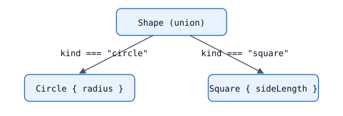

After this lesson you can model "one of several shapes of data" as a union with a discriminant property and narrow it with a single equality check.

## Unions of object types

A union lists the types a value may have. The handbook builds them with `|`, and you can only use members that are common to every member of the union unless you narrow first. [2]

```ts
interface Circle {
  radius: number;
}
interface Square {
  sideLength: number;
}

function getArea(shape: Circle | Square) {
  return Math.PI * shape.radius ** 2;
  //                     ~~~~~~ error: Property 'radius' does not exist on type 'Circle | Square'
}
```

`typeof` is no help here: both members are `"object"`. We need something in the data itself that tells the cases apart.

## Adding a discriminant

Give every member a property with a distinct literal type. That property is called the discriminant (or tag). Checking it narrows the whole union. [3]

```ts
interface Circle {
  kind: "circle";
  radius: number;
}
interface Square {
  kind: "square";
  sideLength: number;
}
type Shape = Circle | Square;

function getArea(shape: Shape): number {
  if (shape.kind === "circle") {
    return Math.PI * shape.radius ** 2; // shape: Circle
  }
  return shape.sideLength ** 2; // shape: Square
}
```



The same works with `switch`, which reads better as the union grows:

```ts
function describe(shape: Shape): string {
  switch (shape.kind) {
    case "circle":
      return `circle of radius ${shape.radius}`;
    case "square":
      return `square of side ${shape.sideLength}`;
  }
}
```

Each `case` narrows `shape` to the matching member. With `strict` enabled the compiler also knows every case returns, because the union is exhausted; the next-but-one lesson makes that guarantee explicit. [3]

## What makes a good discriminant

- A **literal type**: a string literal, number literal, boolean, or `null`/`undefined`. A plain `string` field cannot discriminate, because the compiler cannot tell which member `string` belongs to. [3]
- The **same property name** on every member, with a **different literal** on each.
- Preferably readonly in spirit: do not mutate the tag after construction, or the narrowed type no longer matches the data.

If the names are inconsistent (`type` in one member, `kind` in another), you lose the single check and fall back to user-defined guards.

## Modelling states instead of optional fields

Discriminated unions are also the way to avoid a bag of optional properties:

```ts
// Hard to use: which combinations are legal?
interface Request1 {
  state: "loading" | "success" | "error";
  data?: string;
  error?: Error;
}

// Each state carries exactly what it needs.
type Request2 =
  | { state: "loading" }
  | { state: "success"; data: string }
  | { state: "error"; error: Error };
```

With `Request2`, after `if (r.state === "success")` the field `data` is a definite `string`, with no non-null assertions.

:::low-confidence
The handbook's narrowing page shows discriminated unions using interfaces with literal `kind` fields. Using the pattern for request/response states as above is common practice, but I did not find it stated on the cited page, so treat the design advice as a convention rather than a documented rule. [3]
:::

:::key-takeaways
- Add a literal-typed property with the same name to every union member to make it a discriminated union.
- An equality check or `switch` on that property narrows the union.
- Prefer a union of states over one interface with many optional fields.
:::
