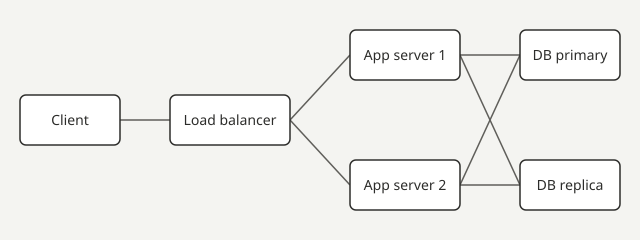

Some questions are about a picture: a diagram, a screenshot, a chart, a map. You click the right place to put a marker, and a question may ask for more than one.

After checking, the correct regions are outlined on the image, your markers are marked right or wrong, and each region explains itself.
